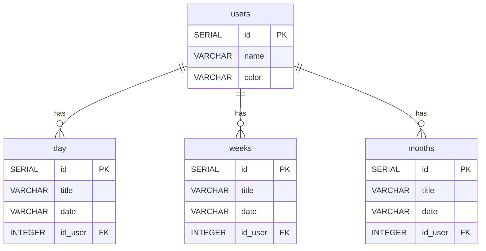

<div align="center">

# 📋 Permalist

A multi-user to-do list web app that organises tasks into three time horizons: **Day**, **Week**, and **Month**.  
Each user gets their own colour-coded list, and all data is persisted in a PostgreSQL database.

🔗 **[Live Demo](https://eight-6-permalist-project-k6by.onrender.com/)** <!-- replace with your Render URL -->

</div>

---

## Preview

> _Add a screenshot of the app here once deployed — replace the path below with your actual image._

```

```

---

## Prerequisites

Before running locally, make sure you have:

- [Node.js](https://nodejs.org/) v18 or higher
- [PostgreSQL](https://www.postgresql.org/) v14 or higher

---

## How it works

When you open the app, it reads a cookie to figure out which user is active. If no user exists yet, you are redirected to a form where you pick a name and a colour. From there you land on the main page, which shows three columns — one for each time horizon.

- **Add** a task by typing in the input field of the column you want and submitting the form.
- **Edit** a task by clicking the edit button next to it, updating the text, and saving.
- **Delete** a task by clicking the delete button next to it.
- **Switch users** with the selector at the top — each user only sees their own tasks.
- **Create a new user** from the same selector by choosing the "new" option.

On the first run the database tables are created automatically and a default user is seeded with some sample tasks so the app starts with something to look at.

---

## Database relations



Each task table (`day`, `weeks`, `months`) references `users(id)` with `ON DELETE CASCADE` — removing a user automatically removes all of their tasks.

---

## Technologies

| Technology | Role |
|---|---|
|  **Node.js** | JavaScript runtime — executes the server-side code |
|  **Express 5** | Web framework — handles routing, middleware, and HTTP requests/responses |
|  **PostgreSQL** | Relational database — stores users and their tasks |
|  **node-postgres (`pg`)** | PostgreSQL client for Node.js — runs queries from the server |
|  **EJS** | Templating engine — renders dynamic HTML pages on the server |
|  **cookie-parser** | Express middleware — reads and writes cookies to track the active user |
|  **dotenv** | Loads environment variables from a `.env` file for local development |

---

## Project structure

```
├── index.js          # Express server, database setup, and all routes
├── views/
│   ├── index.ejs     # Main page (three-column task board)
│   ├── new.ejs       # New-user creation form
│   └── partials/
│       ├── header.ejs
│       └── footer.ejs
├── public/           # Static assets (CSS, client-side JS, images)
├── queries.sql       # Reference SQL for the database schema
├── .env              # Environment variables (not committed)
└── package.json
```

---

## Getting started locally

1. **Install dependencies**
   ```bash
   npm install
   ```

2. **Create a `.env` file** in the project root:
   ```env
   PGUSER=postgres
   PGHOST=localhost
   PGDATABASE=permalist
   PGPASSWORD=your_password
   PGPORT=5432
   ```

3. **Create the database** in PostgreSQL:
   ```sql
   CREATE DATABASE permalist;
   ```
   The tables and seed data are created automatically on first start.

4. **Start the server**
   ```bash
   npm start
   ```

5. Open [http://localhost:3000](http://localhost:3000) in your browser.

---

## Deploying to Render

Set the `DATABASE_URL` (or `INTERNAL_DATABASE_URL`) environment variable in your Render Web Service settings. The app detects it automatically and connects with SSL. Make sure to also switch the `PORT` and `HOST` values near the top of `index.js` to the Render-provided ones (the commented lines are already there).
